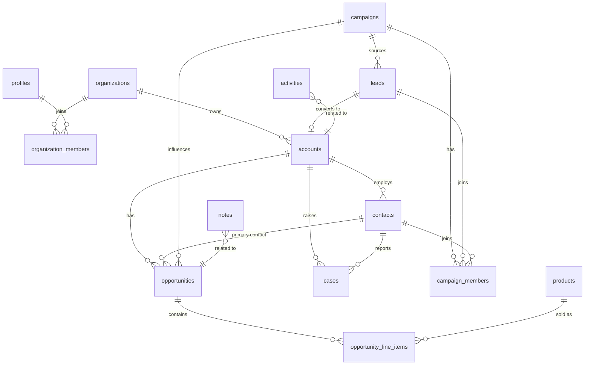

# Cumulus CRM: a Salesforce clone on Supabase

A Salesforce Lightning-style CRM built with **Next.js 16 (App Router)**, **Supabase** (Postgres, Auth, Row Level Security) and **Tailwind CSS 4**. Deploys to Vercel with zero config.

[](https://vercel.com/new/clone?repository-url=https%3A%2F%2Fgithub.com%2Fbryanwoon-jpg%2Fsalesforce-clone&env=NEXT_PUBLIC_SUPABASE_URL,NEXT_PUBLIC_SUPABASE_PUBLISHABLE_KEY&envDescription=Supabase%20project%20URL%20and%20publishable%20key%20(see%20.env.example)&project-name=salesforce-clone)

## Features

- **Sales Cloud objects**: Accounts, Contacts, Leads, Opportunities, Cases, Activities (tasks, calls, emails, events), Campaigns, Products
- **Lightning UI**: global search, tab bar, list views (search, filter, sort, "My" vs "All", pagination), record pages with highlights panel, Details and Related tabs, activity timeline and notes
- **Path**: stage chevrons on Opportunities, Leads and Cases with "Mark as Complete" and closing steps
- **Opportunity Kanban**: drag deals between stages
- **Lead conversion**: one click creates the Account, Contact and (optionally) Opportunity, and carries activities and notes over
- **Opportunity products**: line items with discounts; the opportunity amount rolls up automatically
- **Campaign members**: add leads and contacts with member status
- **Home dashboard and Reports**: pipeline by stage, weighted pipeline, win rate, closed won by month, owner and lead source, cases by status and priority
- **Multi-org tenancy**: every signup gets its own organization (optionally with sample data); admins can add users and switch between orgs

## Architecture

```
src/
  proxy.ts                    Session refresh and auth guard (Next 16 "proxy", formerly middleware)
  lib/objects.ts              Object metadata: fields, list columns, layouts, paths, related lists
  lib/supabase/               Browser, server and proxy Supabase clients (@supabase/ssr)
  app/(app)/[object]/         Generic list, record, new and edit pages driven by objects.ts
  app/(app)/actions.ts        Server actions; every write is validated against the metadata
  components/                 Lightning-style building blocks (Path, Kanban, RecordForm, Timeline...)
supabase/migrations/          Database schema, RLS policies, triggers and RPCs
```

Adding a field is a two-line change: add the column in a migration, then add it to the object in `src/lib/objects.ts`. It appears in the list view, form, record page and validation automatically.

## Database schema



| Table | Purpose |
|---|---|
| `organizations`, `organization_members`, `profiles` | Tenancy. A user can belong to several orgs with a role (admin, manager, user). |
| `accounts`, `contacts`, `leads`, `opportunities`, `cases`, `campaigns`, `products` | CRM objects. Picklists are Postgres enums. |
| `opportunity_line_items` | Products on an opportunity; `total_price` is a generated column. |
| `campaign_members` | A lead **or** a contact on a campaign (check constraint enforces exactly one). |
| `activities`, `notes` | Polymorphic "Who" (lead, contact) and "What" (account, opportunity, case, campaign) links, like Salesforce Tasks and Events. |

**Security.** RLS is on for every table. Members of an org can read, create and edit its records; only the record owner or an org admin can delete. Helper functions live in a non-exposed `private` schema. The `anon` role has no table access.

**Business logic in Postgres.**
- `org_id` defaults to the user's active org, `owner_id` to the current user
- Opportunity stage sets the default probability, `is_closed`, `is_won` and `closed_at`
- Line items roll up into `opportunities.amount`
- Cases stamp `closed_at`; activities stamp `completed_at`
- RPCs: `convert_lead`, `global_search`, `set_active_org`, `create_organization`, `add_org_member`
- Reporting views (`security_invoker`): `opportunity_pipeline`, `lead_funnel`, `cases_by_status`, `monthly_closed_won`
- A signup trigger creates the profile, organization, admin membership and optional sample data

## Run locally

```bash
cp .env.example .env.local   # already points at the salesforce-clone Supabase project
npm install
npm run dev                  # http://localhost:3000
```

## Deploy to Vercel

1. Click **Deploy with Vercel** above (or import the repo at vercel.com/new). Framework preset: Next.js, no build settings needed.
2. Environment variables (values are in `.env.example`; the app also falls back to them if unset):
   - `NEXT_PUBLIC_SUPABASE_URL`
   - `NEXT_PUBLIC_SUPABASE_PUBLISHABLE_KEY`
   - optional `NEXT_PUBLIC_SITE_URL`, your production URL, used in confirmation emails
3. In Supabase, go to **Authentication > URL Configuration**:
   - set **Site URL** to your Vercel URL, e.g. `https://salesforce-clone.vercel.app`
   - add `https://*.vercel.app/**` and `http://localhost:3000/**` to **Redirect URLs**
4. Optional, for quick demos: turn off **Confirm email** under Authentication > Providers > Email, so new signups land straight in the app.

## Applying the schema to another Supabase project

Run the files in `supabase/migrations/` in order (SQL editor, or `supabase db push` with the Supabase CLI). Regenerate types with `npx supabase gen types typescript --project-id <ref>` if you want typed queries.
